<p align="center"></p>

<h1 align="center">Browsi</h1>

<p align="center">
  A native macOS browser built with SwiftUI and WebKit.<br>
  Vertical tabs, Spaces, Liquid Glass, and smart features that run <b>on your Mac</b> with Apple Intelligence.
</p>

<p align="center">
  
  
  
  
</p>

<p align="center"></p>

## Contents

- [Smart features](#smart-features)
  - [Smart answers](#smart-answers) · [Page summary & Q&A](#page-summary--qa) · [Find that understands questions](#find-that-understands-questions) · [Page translation](#on-device-page-translation) · [Page actions](#page-actions) · [Watch a page](#watch-a-page) · [Smart tab titles](#smart-tab-titles) · [Smart Rename for downloads](#smart-rename-for-downloads) · [Smart form fill](#smart-form-fill)
- [Browsing](#browsing)
- [Look & feel](#look--feel)
- [Privacy, passwords & extensions](#privacy-passwords--extensions)
- [Getting started](#getting-started)
- [Keyboard shortcuts](#keyboard-shortcuts)
- [Passwords & signing](#passwords--signing) · [Passkeys](#passkeys) · [Releases & updates](#releases--updates)

---

## Smart features

Browsi's smart features use **Apple Intelligence's on-device model** (Foundation Models) and Apple's
**Translation** framework. Page text, questions and answers never leave your Mac: there's no account,
no API key and no cloud service.

> **Requirements:** a Mac with Apple Intelligence turned on (System Settings › Apple Intelligence & Siri).
> Without it, features fall back where they can: find uses keyword relevance, and smart tab titles still
> remove site names. Translation only needs the language packs, which macOS downloads on first use.

| Feature | Where | What it does |
|---|---|---|
| [Smart answers](#smart-answers) | Home search bar, ⌘↩ | Answers questions, searches the web and your history, cites sources |
| [Page summary & Q&A](#page-summary--qa) | ⌘⇧S / ⌘⇧E | Summarizes the page, then answers questions with clickable citations |
| [Ask the page](#find-that-understands-questions) | ⌘F, then ⌘⇧F | Finds the passages that answer a question and highlights them |
| [Translation](#on-device-page-translation) | ⌥⌘T | Translates the page in place |
| [Page actions](#page-actions) | ⌘K | Calendar events, tables as CSV, comparing tabs |
| [Watch a page](#watch-a-page) | ⌘K › Watch Page… | Notifies you when a page changes in a way you care about |
| [Smart tab titles](#smart-tab-titles) | Sidebar | Shortens long, SEO-stuffed tab titles |
| [Smart Rename](#smart-rename-for-downloads) | Downloads | Gives downloaded files readable names |
| [Smart form fill](#smart-form-fill) | Address & contact forms | Fills forms from your contact card in Contacts |

### Smart answers

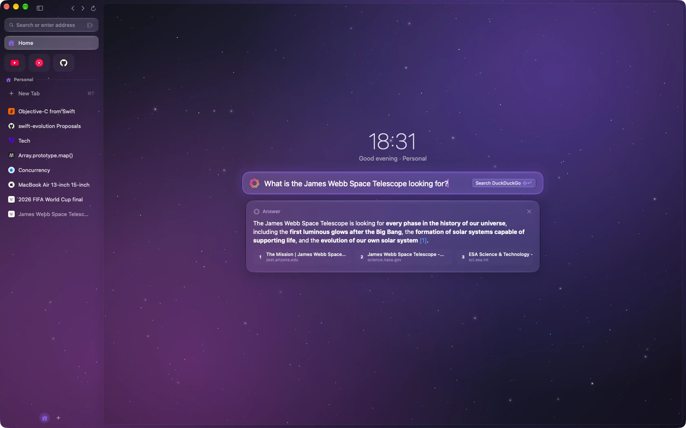

Ask the search bar on the home page a question and Apple Intelligence answers it. The model can
**search the web, read pages and look through your history**, and cites its sources as [1], [2]…, which you
can click.

- The bar shows the same suggestions as the command palette (↑/↓, ↩).
- **⌘↩** asks Apple Intelligence, **⇧↩** searches with your search engine.

### Page summary & Q&A

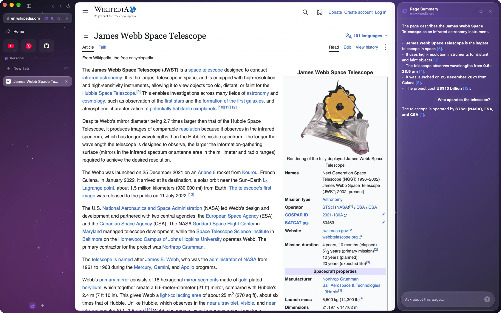

**⌘⇧S** (or the Apple Intelligence button in the address bar) opens a glass side panel with a
one-line gist of the page and its key points. Then you can ask follow-up questions.

- Citations like **[2]** are clickable and scroll the page to that passage.
- **⌘⇧E** opens the same panel as an empty chat, with the cursor in the question field.
- Each tab keeps its own summary and conversation.
- The model's context is small (about 5,000 characters per request), so long pages are summarized from their
  beginning. Questions pull in the passages that match them.

### Find that understands questions

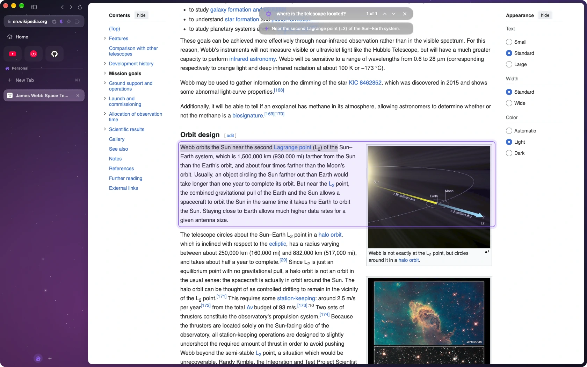

**⌘F** opens a glass find bar with a match count (**⌘G / ⌘⇧G** for next / previous). Press
**⌘⇧F** or **Tab** to switch to *ask* mode and type a question like *"where do they mention refunds?"*:

- Apple Intelligence picks the passages that answer it, **highlights them with a glow** and scrolls to them.
- **↩ / ⇧↩** steps through the passages; a one-line answer appears in the bar.
- **⌘↩** asks from word mode without switching.
- Without Apple Intelligence it ranks passages by keyword relevance.

### On-device page translation

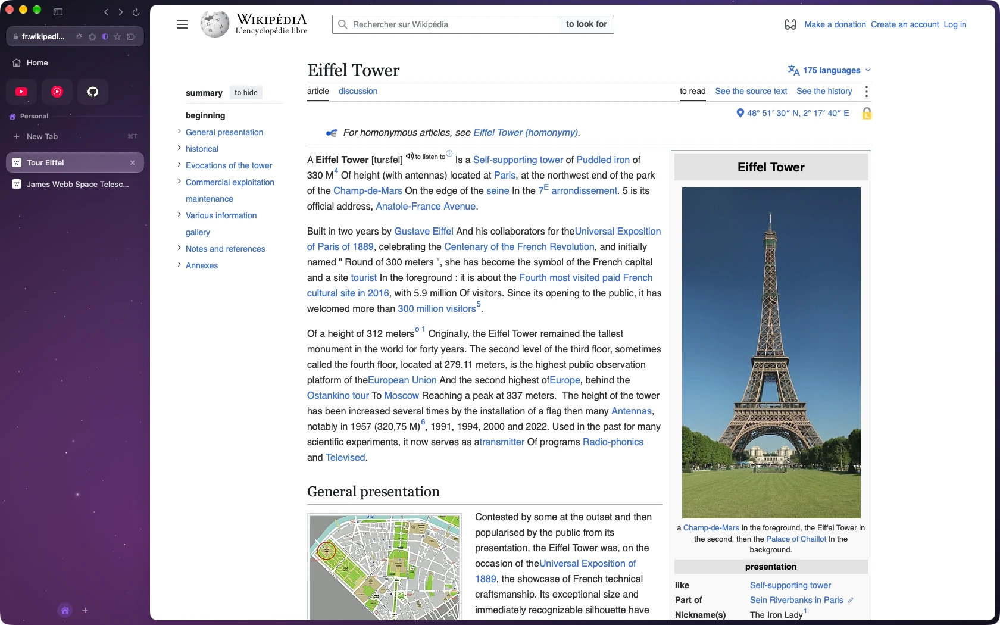

Pages in another language get a **translate button** in the address bar (or press **⌥⌘T**).

- The page is translated **in place**: visible text first, then the rest in batches.
- Click again to show the original. Right-click the button for **Always Translate *language***.
- Turn translation offers on or off in Settings › Websites.
- Uses Apple's Translation framework, not a web service.

### Page actions

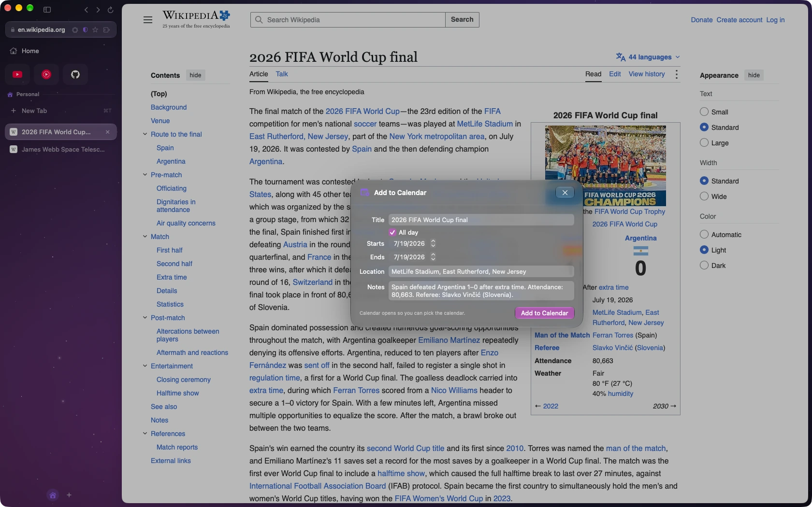

Type in the command palette (**⌘K**). Natural phrasing like *"add this to my calendar"* works too.

| Action | What happens |
|---|---|
| **Add Event to Calendar** | Apple Intelligence finds the event on the page. You check it in an editable card, then it opens in Calendar. |
| **Extract Table as CSV** | Exports real `<table>`s directly, or has the model build a table from lists and cards. Copy it or save it. |
| **Compare Open Tabs** | Puts the current tab and up to 3 recent tabs side by side, with a short verdict. |

### Watch a page

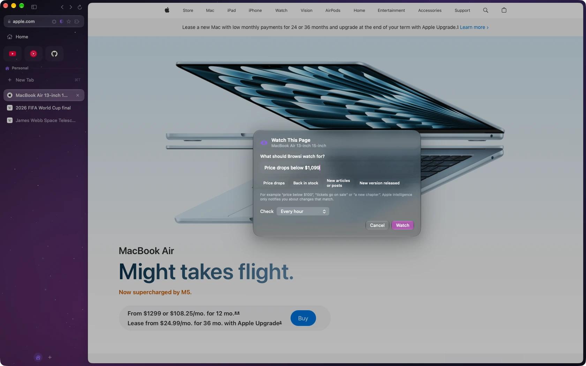

**⌘K › Watch Page for Changes…** (or the Page menu). Say what you're waiting for, e.g.
*"price below $100"*, *"back in stock"* or *"a new chapter"*, or leave it empty for any meaningful change.
Then choose how often to check.

- Browsi re-checks the page in a hidden web view (with your cookies) **every 15 minutes, hour, 6 hours or day**.
- Apple Intelligence ignores noise like clocks, counters and ads, and notifies you only when something
  relevant changed, e.g. *"Price dropped from $129 to $99"*. Click the notification to open the page.
- Watched pages show an **eye** in the address bar (click it to edit or stop watching). Manage all of them in
  Settings › Watched Pages.
- Pages are checked only while Browsi is running.

### Smart tab titles

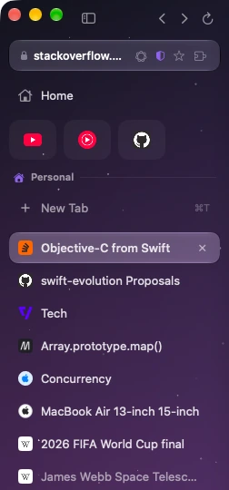

Long or SEO-stuffed titles are shortened in the sidebar:
*"Swift Concurrency | Apple Developer Documentation"* → *"Swift Concurrency"*. Unread counters like *"(3)"* are kept.

- Site names are removed instantly; Apple Intelligence refines the rest when it's available.
- Hover a tab to see its full title. Toggle in Settings › Appearance.

### Smart Rename for downloads

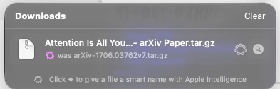

Unclear names like `file_8f3a2c91.pdf` are renamed using the source page and the file's text, e.g.
`Acme Invoice 8823 2026-10.pdf`. Available per file in the download queue, with **Undo Rename**.

---

### Smart form fill

Click into an address or contact form (checkout, shipping, sign-up) and Browsi offers your **My Card** from
Contacts. Pick it, or press ↩, and the name, email, phone, company and address are filled in, including
country menus. Fields are matched by their `autocomplete` attribute and by English, German, French and
Spanish labels. The on-device model works out the ones those can't place. Browsi only fills empty fields,
skips login, search and payment fields, and only fills on HTTPS. It asks for Contacts access the first
time you use it. Toggle in Settings › Passwords › AutoFill.

## Browsing

<table>
  <tr>
    <td width="50%">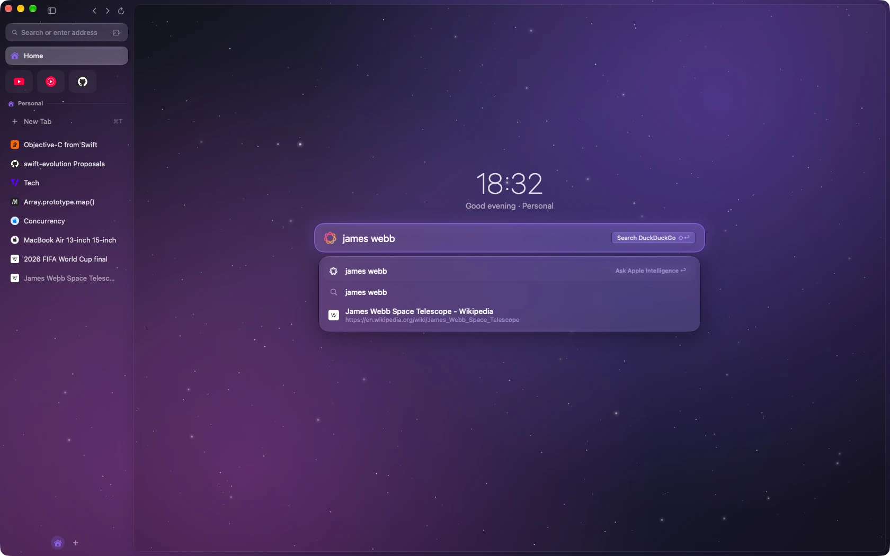</td>
    <td width="50%">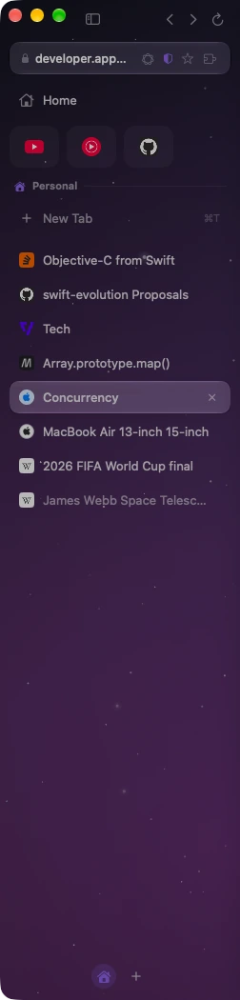</td>
  </tr>
  <tr>
    <td><b>Home page</b> (⌘⇧H): a clock, the smart search bar and a grid of <b>live web pages</b> ("modules") you can drag, resize, zoom and rearrange. Right-click the search bar › <i>Turn On Edit Mode</i> to unlock it. Links open inside their module, or as a tab with ⌘-click / middle-click.</td>
    <td><b>Vertical tabs & Spaces</b>: pinned tiles, drag to reorder, drop a tab on the space header to pin it, hover the left edge to peek at a hidden sidebar. Each space has its own colour, icon and background tint. Switch with ⌃1–9, ⌘⌥←/→ or a two-finger swipe on the sidebar.</td>
  </tr>
  <tr>
    <td>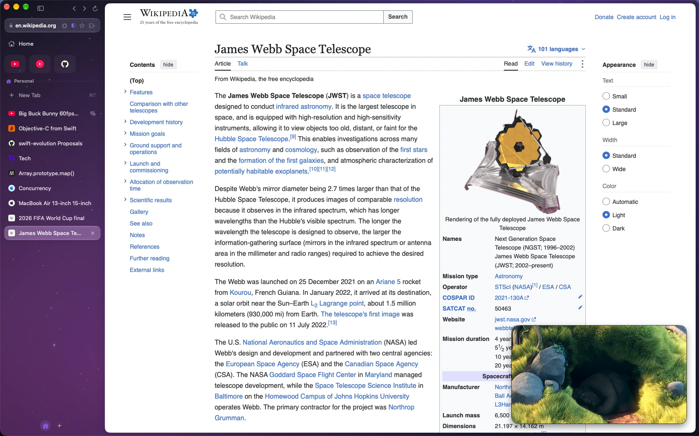</td>
    <td>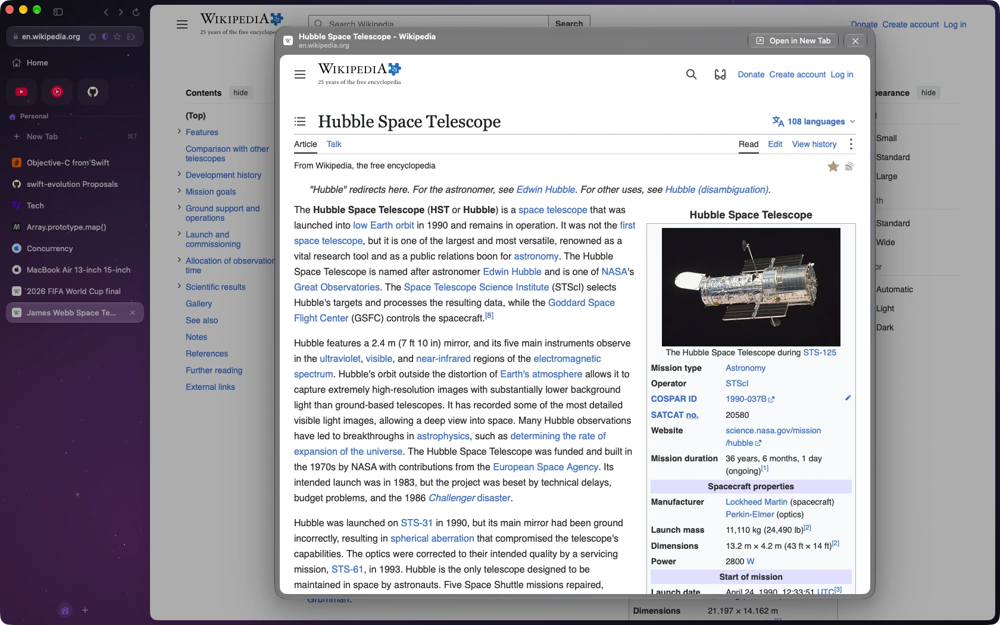</td>
  </tr>
  <tr>
    <td><b>Floating video</b>: leave a tab that's playing a video and the video pops out into a floating window you can drag and resize. Double-click it to go back to the tab.</td>
    <td><b>Link Peek</b>: ⇧-click a link to preview it in a glass window. ⌘↩ opens it as a tab, Esc closes it.</td>
  </tr>
  <tr>
    <td>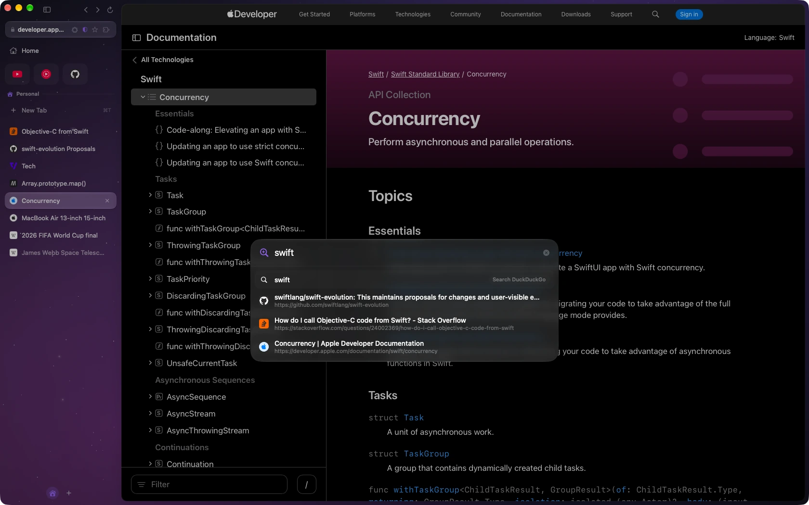</td>
    <td>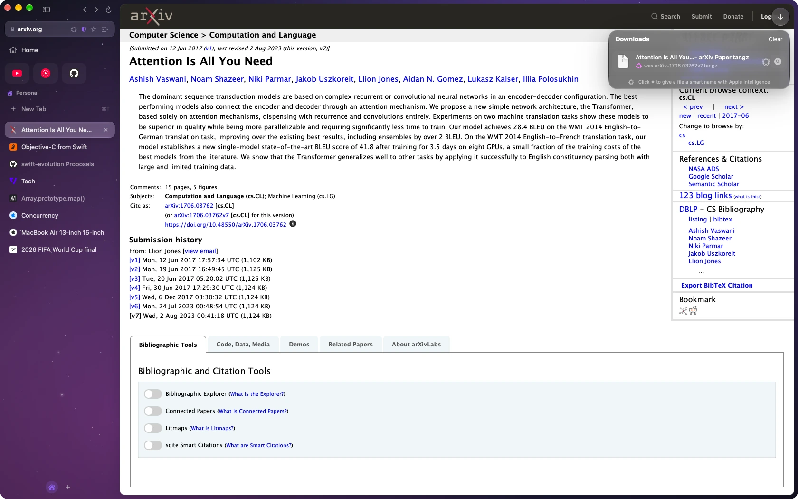</td>
  </tr>
  <tr>
    <td><b>Command palette</b> (⌘T / ⌘L / ⌘K): fuzzy search across open tabs, bookmarks, history and commands. Anything else is opened as a URL or searched.</td>
    <td><b>Download queue</b> (⌘J): a glass button appears top right when a download starts, and files fly into it from where you clicked. Open, reveal, cancel, retry, rename and Smart Rename per file.</td>
  </tr>
</table>

Also:

- **Middle-click** a link to open it in a background tab (⇧ for foreground); middle-click a tab to close it.
- **Mouse thumb buttons** go back and forward.
- **Sessions** (spaces and tabs) are restored on launch. History and bookmarks are stored with SwiftData.
- **Performance**: only the visible tab is attached to the window. Idle tabs are suspended (snapshot and state
  saved, web view released) after a timeout or under memory pressure.

## Look & feel

<table>
  <tr>
    <td width="50%">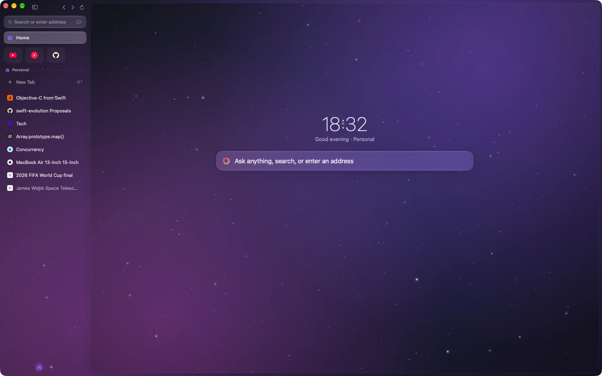</td>
    <td width="50%">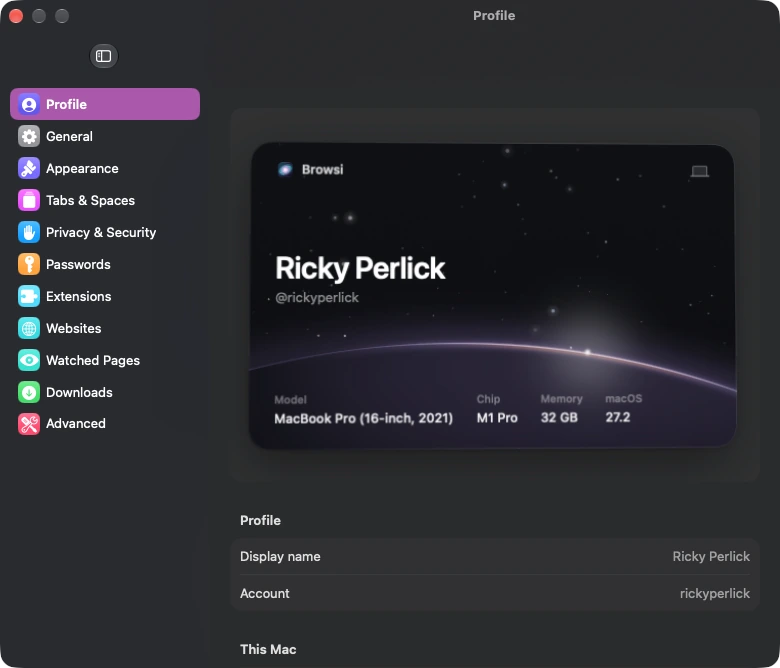</td>
  </tr>
  <tr>
    <td><b>Space theme</b>: a starry night sky behind the whole browser, tinted by each space, with shooting stars on the home page. Adjust intensity or turn it off in Settings › Appearance.</td>
    <td><b>Profile card</b>: Settings › Profile shows your name and this Mac's model, chip, memory and macOS version. The card tilts towards the cursor and the sunrise on the planet follows the pointer.</td>
  </tr>
</table>

- **Liquid Glass & motion**: glass chrome, a morphing tab selection, a glowing progress bar and blur-scale
  transitions. Everything respects Reduce Motion.
- **Wave impact**: clicking "Sign in with Apple" or a passkey button sends a ripple across the page from the
  click (Metal shader). Toggle in Settings › Appearance.
- **Settings**: a System-Settings-style window with about 40 options across General, Appearance, Tabs & Spaces,
  Privacy & Security, Passwords, Websites, Downloads and Advanced.

- **App icons**: Settings › Appearance shows your current icon, a default reset, and compact Space, Exploration and Galaxy collections with 21 icons in total. Pulsar is the default; existing saved choices are kept. Alternate choices change the running app's Dock icon.

## Privacy, passwords & extensions

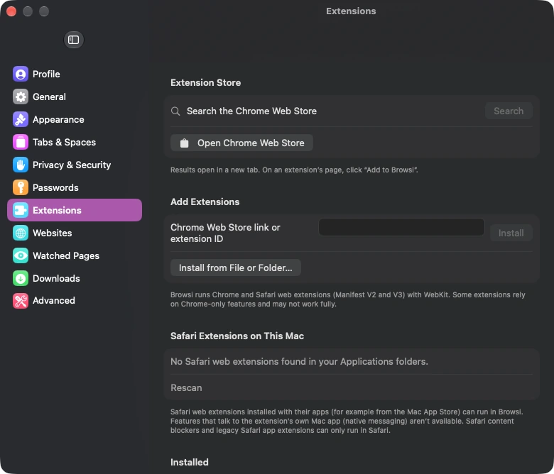

- **Keychain passwords**: Browsi captures logins, offers to save them in the macOS Keychain and autofills them
  behind Touch ID. A password manager is in Settings. Import from Chrome, or from Safari / Firefox CSV exports.
- **Passkeys**: a built-in passkey authenticator that works out of the box, or full system passkeys once
  the build carries Apple's browser passkey entitlement ([details](#passkeys)).
- **Tracker & ad blocking**: a compiled WebKit content rule list, toggled per site from the shield in the
  address bar.
- **Extensions**: turn on **Safari web extensions** installed with their apps, or install **Chrome Web Store**
  extensions (paste a link, click "Add" on the store page, or load a .crx / .zip / unpacked folder). Runs on
  WebKit's web extension engine (MV2 + MV3) with a compatibility shim for Chrome-only APIs. Good picks:
  uBlock Origin Lite, Dark Reader, SponsorBlock, Return YouTube Dislike, Bitwarden.

---

## Getting started

> Requires **macOS 26+** (Liquid Glass APIs) and **Xcode 26+**.

```sh
brew install xcodegen
scripts/build.sh            # generate Browsi.xcodeproj + build
scripts/build.sh test       # run unit tests (Swift Testing)
open build/Build/Products/Debug/Browsi.app
```

To work in Xcode, run `xcodegen generate` and open `Browsi.xcodeproj`. The project file is generated and
git-ignored; `project.yml` is the source of truth.

## Keyboard shortcuts

| Action | Shortcut |
|---|---|
| Edit address | ⌘L |
| New tab (palette) / Home / Command palette | ⌘T / ⌘⇧H / ⌘K |
| Close tab / Reopen closed tab | ⌘W (pinned tabs stay pinned, just unloaded) / ⌘⇧T |
| Toggle sidebar | ⌘S |
| Bookmark page / Pin tab | ⌘D / ⌘⇧P |
| Back / Forward / Reload | ⌘[ / ⌘] (or mouse thumb buttons) / ⌘R |
| Select tab 1–9 / Next–previous tab | ⌘1–9 / ⌃Tab, ⌘⇧] ⌘⇧[ |
| Select space 1–9 / Next–previous space | ⌃1–9 / ⌘⌥→ ⌘⌥← |
| New space | ⌘⇧N |
| Link Peek / open peek as tab / close | ⇧-click / ⌘↩ / Esc |
| Open link in new tab / close tab | Middle-click link / middle-click tab |
| Downloads | ⌘J |
| Summarize page / ask about page (empty chat) | ⌘⇧S / ⌘⇧E |
| Find / ask the page / next–previous match | ⌘F / ⌘⇧F / ⌘G ⌘⇧G (↩ ⇧↩ in the bar) |
| Translate page / show original | ⌥⌘T |
| Zoom | ⌘+ / ⌘- / ⌘0 |

## Passwords & signing

Logins are stored as `kSecClassInternetPassword` items labelled `Browsi`. An ad-hoc-signed build (the default) uses
the login keychain. If you sign with an Apple Development team, Browsi switches to the data-protection keychain
automatically, and the *Sync via iCloud Keychain* toggle takes effect. Browsi cannot read Safari's or the Passwords
app's entries.

## Passkeys

Browsi ships its **own passkey authenticator**, so passkeys work without anything from Apple: when a site
asks to create or use a passkey, Browsi generates a P-256 key, stores it in your macOS Keychain and asks
for Touch ID (or your login password) every time. Registration and sign-in are verified end to end
against [webauthn.io](https://webauthn.io) in the test suite. Manage saved passkeys in
Settings › Passwords › Passkeys.

Limits of the built-in authenticator: its passkeys live only in Browsi (not in iCloud Keychain), you
can't use passkeys saved by Safari / the Passwords app or sign in with your iPhone, passkey autofill
(conditional UI) isn't offered, and sites that demand hardware attestation may refuse it.

For full system passkeys (iCloud Keychain, password-manager apps, iPhone via QR code, security keys, passkey
autofill), Browsi needs Apple's **Web Browser Public Key Credential** entitlement
(`com.apple.developer.web-browser.public-key-credential`). Once a build carries it, Browsi switches to
the system automatically and stops injecting its own authenticator.

<details>
<summary><b>Enabling system passkeys</b></summary>

1. **Request the entitlement** for your team via the request form linked from Apple's [Passkey use in web browsers](https://developer.apple.com/documentation/authenticationservices/passkey-use-in-web-browsers) documentation (sign in with your developer account; macOS browser, bundle id `dev.perlick.browsi`).
2. Once Apple grants it, in *Certificates, Identifiers & Profiles*:
   - register the App ID `dev.perlick.browsi` and enable the **Web Browser Public Key Credential** capability;
   - make sure you have an **Apple Development** (and later **Developer ID Application**) certificate;
   - create a **macOS App Development** provisioning profile for that App ID that includes your Mac, name it e.g. `Browsi Passkeys Development`, download it and double-click to install.
3. `cp Config/Signing.local.xcconfig.example Config/Signing.local.xcconfig` and adjust the team / profile name (the file is git-ignored).
4. `scripts/build.sh`, launch, then Settings › Passwords › Passkeys › **Allow…**. macOS then lists Browsi under
   System Settings › Privacy & Security › Passkeys Access for Web Browsers. Clicking a passkey button on a site also prompts.
5. For distribution, use a Developer ID profile with the same capability and `CODE_SIGN_IDENTITY = Developer ID Application`, then notarize.

Team signing also moves saved passwords to the data-protection keychain and makes the iCloud sync toggle work.

</details>

## Releases & updates

`.github/workflows/release.yml` builds and tests every push and pull request. Pushing a tag `vX.Y.Z` also builds a
Release app (version from the tag, build number from the run number), zips it, signs an `appcast.xml` with Sparkle's
EdDSA key (repo secret `SPARKLE_PRIVATE_KEY`) and publishes both as a GitHub release. Tags with a `-` (e.g. `v1.0.0-beta1`)
become pre-releases, which the updater ignores.

```sh
git tag v0.2.0 && git push origin v0.2.0
```

The app updates itself with [Sparkle 2](https://sparkle-project.org): it reads
`https://github.com/RickyDane/browsi/releases/latest/download/appcast.xml`, verifies the archive against `SUPublicEDKey`
in `Info.plist`, and installs through Sparkle's sandbox-safe installer service. Browsi › **Check for Updates…**, or
Settings › General › Updates. The private key also lives in the login keychain of the Mac that created it
(`generate_keys -x key.txt` exports it); losing it means existing installs can't verify new updates.

CI builds are ad-hoc signed and not notarized, so the first download needs right-click › Open (or
`xattr -dr com.apple.quarantine Browsi.app`); updates installed by Sparkle afterwards aren't quarantined.

## Further reading

- [INFO.md](INFO.md): architecture, data flow, status and roadmap.
- [AGENTS.md](AGENTS.md): conventions for contributors and coding agents.
- [docs/screenshots](docs/screenshots/README.md): the shot list for the images in this README.
